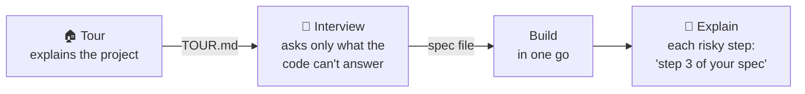

# every-corner-skills

**Claude Code skills that make the AI work like a good senior developer: it understands your project, asks the right questions before building, and explains every risky step in plain English.**

## The problem

Working with an AI coding agent usually goes wrong in one of three ways:

1. **You don't understand the project, and neither does the AI.** It edits code without knowing how the pieces fit together.
2. **The AI guesses what you meant.** You say "add favorites", it builds *its* idea of favorites, and you find out it's wrong after the code is written.
3. **You click Accept without understanding.** In manual mode it keeps asking things like this, and beginners just approve:

```
Run command: git push --force origin feature/login
[ Accept ]  [ Reject ]
```

Research backs this up. When requirements are incomplete, AI code accuracy drops by 35-52%, yet models ask clarifying questions in under 40% of cases. Users approve 93% of permission prompts, and people stop reading a repeated warning after the second time.

## The three skills

Think of your project as a house.

| Skill | When | What it does |
|---|---|---|
| 🏠 **every-corner-tour** | You join or return to an existing project | Reads every corner of the house and explains how it works, like a friend showing you around. Proves what it covered. |
| 🧱 **every-corner-interview** | You want to build a new feature or project | Treats your request as a new room. Reads the project first, then asks every question that would change the build, and only those, until the room is fully described. Then it builds it in one go. |
| 🛑 **every-corner-explain** | While the AI works | Before each risky action, explains in plain English what will happen and whether it can be undone. Safe actions stay quiet. |

Plus an optional **safety-net hook** that catches dangerous shell commands even if the AI forgets.

## How they work together



Each skill hands its notes to the next one. The tour writes `docs/every-corner/TOUR.md`, so the interview skips every question the tour already answered. The interview writes `docs/every-corner/specs/<feature>.md`, so the build follows exactly what you agreed and each explanation can point to it.

## See it in action

**Interview:** you say *"Add a favorites feature."* Instead of guessing, Claude reads the project, then asks:

> **A user favorites a recipe that the author later deletes. What should they see?**
> ○ It disappears from their favorites quietly (Recommended)
> ○ A grey "This recipe was removed" placeholder

It keeps asking until every part of the room is clear: one question for a small change, twenty for a big one. It never asks something it could have looked up. Then it writes the spec and builds.

**Explain:** the same force push, after:

```
⛔ CANNOT BE UNDONE
What: Replace the feature/login branch on the server with your local copy.
Why: You cleaned up your commits, so a normal push is rejected.
Changes: The shared branch on the server.
Undo: Not possible. Teammates' commits on that branch would be lost.
Safer option: git push --force-with-lease (refuses to overwrite work you haven't seen).
Check this: Nobody else is working on this branch.
```

Full examples: [tour](examples/tour-example.md) · [interview](examples/interview-example.md) · [explain](examples/permission-explanations.md)

## Install (1 minute)

Inside [Claude Code](https://claude.com/claude-code), run:

```
/plugin marketplace add ssaaffaakk/every-corner-skills
/plugin install every-corner@every-corner-skills
```

Or from a terminal:

```bash
claude plugin marketplace add ssaaffaakk/every-corner-skills
```

```bash
claude plugin install every-corner@every-corner-skills
```

Start a new session and you're done. You get all three skills plus the safety-net hook, for about **300 tokens per session** until a skill is actually used.

**Use them:**

- New to a project? Say *"Give me a tour of this project."*
- Building something? Say *"Interview me, I want to add <your feature>."*
- The explanations before risky actions appear on their own.

**Turn off the safety-net hook:** run `/plugin configure every-corner@every-corner-skills` and switch off "Safety-net hook". The skills keep working. The hook needs `jq`; without it, the hook simply stays out of the way.

**Update later:** `/plugin marketplace update every-corner-skills`, then restart.

<details>
<summary>Install without the plugin system (copy the files)</summary>

```bash
git clone https://github.com/ssaaffaakk/every-corner-skills.git
cd every-corner-skills
mkdir -p ~/.claude/skills
cp -R skills/every-corner-tour skills/every-corner-interview skills/every-corner-explain ~/.claude/skills/
```

To install for one project only (so your team gets them too), copy them into that project's `.claude/skills/` folder instead. The hook then needs a manual setup: see [hooks/README.md](hooks/README.md).

</details>

## Questions

**Won't the interview ask too many questions?**
It asks as many as the feature needs, and only questions that pass four tests: only you can answer it, the answer changes the build, it hasn't been asked already, and you can realistically answer it. Everything else becomes a written default you can see. You can say "build now" at any time.

**Won't the tour cost a lot of tokens?**
It reads in tiers: it lists every file, outlines every source file, and reads only the core paths in full. It saves the result with the commit it was made at, so next time it only re-reads folders that changed.

**Will I get flooded with explanations?**
No. Read-only actions get nothing, easy-to-undo ones get one line, and only hard-to-undo or irreversible actions get the full card.

**Can I trust the explanations?**
They come from the same AI that proposed the action, so treat them as a helper, not a guarantee. The skills require file and line references, honest "I'm not sure" statements, and a "Check this" line on risky actions.

## Built on what already works

These skills combine the best ideas from existing projects and research rather than reinventing them:

- **Interview:** the question taxonomy and recommended-answer pattern of [GitHub Spec Kit](https://github.com/github/spec-kit)'s `/clarify`; the size triage of [superpowers](https://github.com/obra/superpowers) brainstorming; Anthropic's "interview, write a spec, build in a fresh session" workflow; EARS requirement sentences; Volere's rule that every requirement needs a testable check; and findings from Ambig-SWE, HumanEvalComm, SAGE-Agent and ClarifyCodeBench on which questions actually help.
- **Tour:** the step format and verified anchors of [code-tour](https://github.com/github/awesome-copilot/tree/main/skills/code-tour); beginner chapters with analogies from [PocketFlow Tutorial-Codebase-Knowledge](https://github.com/The-Pocket/PocketFlow-Tutorial-Codebase-Knowledge); the "Where to Look" table from ECC's onboarding skill; ranked repo maps from [Aider](https://aider.chat/docs/repomap.html).
- **Explain and the hook:** risk-tiered warnings from security research on warning habituation, and dangerous-command patterns inspired by [dcg](https://github.com/Dicklesworthstone/destructive_command_guard) and similar guards. For a more thorough command guard, use one of those alongside this hook.

The full research report behind these choices is summarized in [docs/how-it-works.md](docs/how-it-works.md).

## Contributing

Real before/after examples, new hook patterns and fixes are welcome. Read [CONTRIBUTING.md](CONTRIBUTING.md), then open an [issue](https://github.com/ssaaffaakk/every-corner-skills/issues) or a pull request. Issues labeled `good first issue` are a good place to start.

## License

[MIT](LICENSE)
