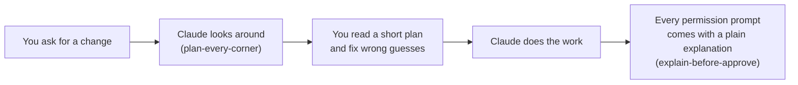

# safak-skills

**Claude Code skills that help you understand what the AI is doing, before and while it does it.**

## The problem

When you use Claude Code in manual mode, it keeps asking for permission:

```
Run command: git push --force origin feature/login
[ Accept ]  [ Reject ]
```

If you are new, you do not know what that does. So you click **Accept** and hope. And when Claude builds the wrong thing, you only find out after the code is written.

## What this repo gives you

| | What it is | In one sentence |
|---|---|---|
| 🔎 **plan-every-corner** | A skill | Before writing code, Claude looks around the project like a senior developer and shows you a short plan to approve. |
| 💬 **explain-before-approve** | A skill | Before every permission prompt, Claude explains in plain words what it is about to do and whether you can undo it. |
| 🛟 **explain-risky-commands** | An optional hook | Adds a plain-language warning to dangerous commands like `rm -rf` or `git push --force`, even if Claude forgets. |

## See it in action

The same command, before and after:

**Before:** `Run command: git push --force origin feature/login`

**After:**

> **What:** Replace the `feature/login` branch on the server with the version on your computer.
> **Why:** You cleaned up your commits, so a normal push is rejected.
> **Changes:** The shared branch on the server. Other people's commits on it will be removed.
> **Undo:** Hard to undo.
> **Check this:** Nobody else is working on this branch.

Now you can decide, instead of guessing.

## How it works



1. **Look around first.** Claude checks the files, the config, the history and the surprises hiding in the code. It reports what it found, what it only guessed, and what it plans to do.
2. **You correct the guesses.** Fixing a wrong guess in a plan takes 30 seconds. Fixing it in finished code takes much longer.
3. **Understand each step.** While Claude works, every permission prompt says what, why, what changes, and whether it can be undone.

Want the full detail? Read [how it works](docs/how-it-works.md).

## Install (2 minutes)

You need [Claude Code](https://claude.com/claude-code) and a terminal.

**1. Get the files**

```bash
git clone https://github.com/ssaaffaakk/safak-skills.git
cd safak-skills
```

**2. Copy the two skills**

```bash
mkdir -p ~/.claude/skills
cp -R skills/plan-every-corner ~/.claude/skills/
cp -R skills/explain-before-approve ~/.claude/skills/
```

**3. Start a new Claude Code session.** Skills load when a session starts.

That is it. To use them, ask for a task and say **"use plan-every-corner"**. The explanations appear on their own when Claude asks for permission.

To install them in one project only, copy them into that project's `.claude/skills/` folder instead. Your team then gets them too.

> **Optional:** the safety-net hook for dangerous commands needs one extra setup step. See [hooks/README.md](hooks/README.md).

## Questions

**Does it make Claude slower?**
A little, at the start. The look-around step takes a minute, and it saves you from rebuilding things that were built on a wrong guess. Tiny changes, like fixing a typo, skip it.

**Will I get flooded with explanations?**
No. Safe, read-only actions get one line or nothing. Only risky actions get the full explanation.

**Can I trust the explanations?**
They come from the same AI that proposed the action, so they can be wrong. That is why the skills require evidence (file and line numbers), honest "I'm not sure" statements, and a "Check this" line on risky actions. Treat the explanation as a helper, not as a guarantee.

**Does it work with other AI coding tools?**
These are written for Claude Code. The ideas should transfer, but we have not tested them elsewhere.

## Examples

- [A full plan-every-corner report](examples/room-report-example.md)
- [Permission explanations, before and after](examples/permission-explanations.md)

## Contributing

New hook patterns, real before/after examples and fixes are welcome. Read [CONTRIBUTING.md](CONTRIBUTING.md), then open an [issue](https://github.com/ssaaffaakk/safak-skills/issues) or a pull request. Issues labeled `good first issue` are a good place to start.

## License

[MIT](LICENSE)
