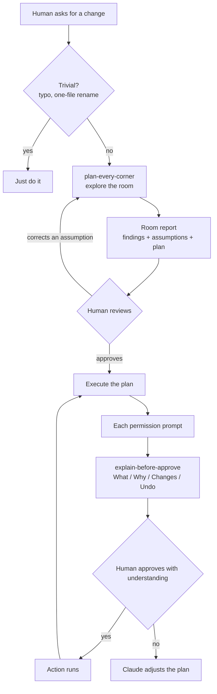

# skills

A collection of Claude Code skills. The first set is **plan every corner**:

**Two Claude Code skills that make AI-assisted coding understandable for the human in the loop.**

In manual-approval mode, Claude asks permission constantly. Juniors (and tired seniors) learn to click "accept" on commands they do not understand. And when the plan was built on a wrong assumption, the mistake only shows up after the code is written.

This repo attacks both problems:

| Skill | When it runs | What it does |
|---|---|---|
| [`plan-every-corner`](skills/plan-every-corner/SKILL.md) | **Before** work starts | Explores the "room" the task lives in and produces a short, evidence-backed report and plan the human approves |
| [`explain-before-approve`](skills/explain-before-approve/SKILL.md) | **During** work, at every permission prompt | Explains what is about to happen in plain language: what, why, what changes, can it be undone |

An optional [hook](hooks/explain-risky-commands.sh) adds a plain-language warning to the most dangerous shell commands, even if the model forgets.

The goal: **fewer wrong first attempts, and approvals people actually understand.**

---

## How it fits together



The two skills reinforce each other. The approved plan gives every later permission prompt a reason ("this is step 3 of the plan you approved"), so the explanation connects to something the human already understands.

---

## The room metaphor

Before writing code, a senior engineer figures out what is in the room. The skill walks the same path, in order of how likely each area is to change the plan.

```mermaid
flowchart LR
    subgraph Room["The room: the task"]
        direction TB
        R1[What exactly is asked?<br/>What does done look like?]
    end
    subgraph Desk["The desk: directly in front"]
        direction TB
        D1[Files to change]
        D2[Who calls them]
        D3[Tests that cover them]
    end
    subgraph Drawers["The drawers: close by, hidden"]
        direction TB
        W1[Config and env vars]
        W2[Schemas and types]
        W3[Conventions: one good example]
        W4[Lint, CI, hooks]
    end
    subgraph Rug["Under the rug: surprises"]
        direction TB
        U1[HACK / TODO comments]
        U2[git blame on odd code]
        U3[Dynamic references,<br/>generated files, duplicates]
        U4[Flaky or skipped tests]
    end
    subgraph Doors["The doors: the outside"]
        direction TB
        O1[Database, APIs, services]
        O2[Anything leaving the machine]
        O3[Anything hard to undo]
    end
    Room --> Desk --> Drawers --> Rug --> Doors
    Doors --> Report[Room report]
```



| Part of the room | What to look for | Failure it prevents |
|---|---|---|
| **Room** | The task in two sentences, and an observable "done" | Building the wrong thing |
| **Desk** | Files, callers, tests | Breaking a caller you did not know about |
| **Drawers** | Config, schema, conventions, CI | Inventing a new pattern; a change CI will reject |
| **Under the rug** | TODOs, history, dynamic use, flaky tests | Re-introducing a bug someone already fixed on purpose |
| **Doors** | External systems, irreversible actions | A side effect nobody expected |

### Not an AI-slop repo tour

The failure mode of "understand the codebase" prompts is a long, impressive summary that restates the README. This skill has rules against that:

- **Only search what could change the plan.** Stop when one more search would not change what you would do.
- **Every claim carries evidence:** a `file:line`, a command that was run, or a commit. Anything unverified is labeled **assumed**.
- **Absence is reported:** "searched for X, found nothing."
- **Depth scales with risk.** Typo: no tour. Auth or data: full pass.
- **At most three questions**, only where the answer changes the plan, each with a default so the human can just say "go".

See a full [example room report](examples/room-report-example.md).

---

## What a permission prompt looks like after

Before:

```
Run command: git push --force origin feature/login
[ Accept ]  [ Reject ]
```

After:

> **What:** Replace the `feature/login` branch on the server with the version on your computer.
> **Why:** You rewrote local history while cleaning up commits, so a normal push is rejected.
> **Changes:** The shared branch on the server. Others' commits on it will be removed.
> **Undo:** Hard to undo; commits that exist only on the server are lost.
> **Check this:** Nobody else is working on this branch.

Explanations scale with risk so they do not turn into noise:

| Level | Examples | Explanation |
|---|---|---|
| Quiet | read files, search, `git status` | none, or one line |
| Standard | edit project files, run tests, build | four-line shape |
| Careful | delete, install, migrate, network, `git push`, `sudo` | four-line shape **plus** "Check this" |

More in [permission-explanations.md](examples/permission-explanations.md), including the case where Claude honestly says *"I haven't read this script, so I can't say what it deletes. Let me read it first."*

---

## Install

### Skills

Copy the skill folders into your Claude Code skills directory.

For all your projects:

```bash
mkdir -p ~/.claude/skills
cp -R skills/plan-every-corner ~/.claude/skills/
cp -R skills/explain-before-approve ~/.claude/skills/
```

For one project only (commit it so the whole team gets it):

```bash
mkdir -p .claude/skills
cp -R skills/plan-every-corner .claude/skills/
cp -R skills/explain-before-approve .claude/skills/
```

Claude picks a skill up automatically when its `description` matches the situation, and you can also invoke one by name (for example `/plan-every-corner`).

### Optional: the safety-net hook

A skill depends on the model remembering to explain. A hook runs every time, so the riskiest shell commands always carry a plain-language warning. It needs `jq`.

1. Copy the script somewhere stable and make it executable:

   ```bash
   mkdir -p ~/.claude/hooks
   cp hooks/explain-risky-commands.sh ~/.claude/hooks/
   chmod +x ~/.claude/hooks/explain-risky-commands.sh
   ```

2. Register it in `~/.claude/settings.json` (or the project's `.claude/settings.json`):

   ```json
   {
     "hooks": {
       "PreToolUse": [
         {
           "matcher": "Bash",
           "hooks": [
             { "type": "command", "command": "~/.claude/hooks/explain-risky-commands.sh" }
           ]
         }
       ]
     }
   }
   ```

If you already have a `hooks` section, merge this entry into it instead of replacing it.

What it flags, and the warning it shows:

| Command pattern | Warning |
|---|---|
| `rm -rf` | Deletes permanently, no trash, no undo |
| `git push --force` | Overwrites the server branch; teammates' work can be lost |
| `git reset --hard` | Throws away uncommitted changes |
| `git clean -f` | Deletes untracked files that cannot be recovered |
| `curl ... \| sh` | Runs a downloaded script without you seeing it |
| `sudo` | Runs with administrator rights |
| `DROP TABLE`, `TRUNCATE TABLE` | Permanently removes database data |
| `chmod 777` | Opens files to every user on the machine |

Safe commands pass through silently. The hook only turns the normal prompt into one with a clearer reason. It does not block anything on its own.

> **This is a safety net, not a security boundary.** Pattern matching is easy to get around and will miss things. For hard guarantees, use Claude Code's permission rules and a sandbox.

---

## Usage tips

- **Start a task with the room report.** Say "use plan-every-corner" for anything that touches data, auth, config, or more than one file.
- **Correct the assumptions, not the code.** The cheapest place to fix a misunderstanding is the "Assumed, not verified" list.
- **Teaching juniors:** have them explain the plan back before approving it. If they cannot, the plan was not plain enough, and that is worth fixing.
- **Tune the thresholds.** If your team finds Standard explanations too chatty, edit the table in `explain-before-approve/SKILL.md`.

---

## Honest limits

- It raises the odds of a clean first attempt. It does not guarantee one. Some context lives in people's heads, not in files, and the report lists that under "assumed".
- The explanation comes from the same model that proposed the action. A wrong plan can arrive with a confident explanation. That is why the skill requires evidence, plain statements of uncertainty, and a "Check this" line for risky actions.
- Explanations can become noise. The three-level scheme exists to prevent that; keep it.

---

## Repo layout

```
skills/
├── skills/
│   ├── plan-every-corner/SKILL.md
│   └── explain-before-approve/SKILL.md
├── hooks/
│   └── explain-risky-commands.sh
├── examples/
│   ├── room-report-example.md
│   └── permission-explanations.md
├── LICENSE
└── README.md
```

## Contributing

Ideas that would help: more hook patterns (with a test case for each), translations of the example reports for other stacks, and real-world before/after permission explanations. Open an issue or a pull request.

## License

[MIT](LICENSE)
