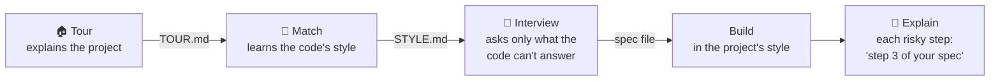

<div align="center">


<h3><em>Understand the project. Get asked the right questions. Approve only what you understand.</em></h3>

<p>
  <a href="https://github.com/ssaaffaakk/every-corner-skills/actions/workflows/test-hook.yml"></a>
  
  
  
  <a href="LICENSE"></a>
  <a href="https://github.com/ssaaffaakk/every-corner-skills/stargazers"></a>
</p>

<p>
  <a href="#-install-in-30-seconds"><b>Install</b></a> ·
  <a href="#-meet-the-skills"><b>Skills</b></a> ·
  <a href="#-see-it-in-action"><b>Demo</b></a> ·
  <a href="#-how-it-works"><b>How it works</b></a> ·
  <a href="#-faq"><b>FAQ</b></a>
</p>

</div>

---

Your AI coding agent is fast. But it **edits code it doesn't understand**, **builds what it guessed you meant**, and **asks you to approve commands you can't read**.

**every corner** fixes all three with four small skills that make Claude Code behave like the senior developer you wish you had next to you.

## 🚀 Install in 30 seconds

Inside Claude Code:

```
/plugin marketplace add ssaaffaakk/every-corner-skills
/plugin install every-corner@every-corner-skills
```

Start a new session. That's it: four skills and two small hooks, for about **470 tokens per session** until a skill is actually used.

<details>
<summary>Prefer the terminal, or copying files by hand?</summary>

From a terminal:

```bash
claude plugin marketplace add ssaaffaakk/every-corner-skills
```

```bash
claude plugin install every-corner@every-corner-skills
```

Without the plugin system:

```bash
git clone https://github.com/ssaaffaakk/every-corner-skills.git
cd every-corner-skills
mkdir -p ~/.claude/skills
cp -R skills/every-corner-tour skills/every-corner-interview skills/every-corner-matchcodebase skills/every-corner-explain ~/.claude/skills/
```

The hook then needs a manual setup: see [hooks/README.md](hooks/README.md).

</details>

## 🧭 Meet the skills

| If you're... | Use | Just say |
|---|---|---|
| 🏠 new to a project | **every-corner-tour** | *"Give me a tour of this project."* |
| 🧱 about to build something | **every-corner-interview** | *"Interview me, I want to add favorites."* |
| 🧬 adding code to someone else's project | **every-corner-matchcodebase** | *"Match this project's style, then add favorites."* |

🛑 **every-corner-explain** needs no command: it steps in on its own whenever Claude asks for permission to do something risky.

### 🏠 every-corner-tour: *finally understand the codebase*

> You just joined a project and have no idea how it fits together. Get the tour a senior teammate would give you on day one, without having to ask.

- 📖 **A story, not a file list.** One real flow, from the user's click to the database, told step by step.
- 🗺️ **A map you can use.** A diagram, a glossary, and a "where to look when you want to…" table.
- ⚠️ **The gotchas, up front.** The hacks and traps in the code, with the git history explaining why they're there.
- ✅ **Proof it read every corner.** Every folder is marked explained, mentioned, or skipped and why. Nothing is skipped silently.
- 💾 **Remembered.** Saved to `TOUR.md`; next time it only re-reads what changed.

### 🧱 every-corner-interview: *built right the first time*

> Stop rebuilding features the AI guessed wrong. It asks what only you know, writes it down, and then builds exactly that.

- 🔍 **Reads before it asks.** It never asks what your code already answers.
- 🎯 **One-click questions.** Each has a recommended answer. As many as the feature needs, none wasted.
- 🧩 **Catches what AI usually misses.** Empty states, duplicates, sort order, deleted data, two users at once.
- 📝 **A spec you can hold it to.** Every requirement gets a testable "done" check.
- 🔁 **Builds, then checks itself.** When it's done, it reviews the result against the spec, line by line.

### 🧬 every-corner-matchcodebase: *new code that looks like it was always there*

> The project you're joining may look nothing like what an AI writes by default. It studies how the code is really written and used, then writes in exactly that style.

- 🧮 **Counts every file, reads only what matters.** A small script (no AI tokens) tallies indentation, quotes, naming, imports, error handling and test layout across the whole project. The agent reads in full only the config, the area it will touch, a few examples and the odd files out.
- 🔒 **Read-only study.** It never runs or installs your project while learning.
- 📝 **Short style notes.** `STYLE.md` keeps only what your tools don't already enforce, each rule with a quoted example you can open.
- 🧪 **Checks its own work.** After writing, it runs your formatter, linter and tests, then compares naming and structure with the nearest existing file.
- ♻️ **Cached by commit.** An unchanged project costs almost nothing the second time. Bugs it finds in the old code are reported, not copied.
- 🪝 **Starts on its own.** A small hook stops the first code edit in a project that has code but no style notes, once per session, and sends the agent to this skill first. Switch it off with `/plugin configure every-corner@every-corner-skills`.

### 🛑 every-corner-explain: *never click Accept blindly again*

> Know exactly what you're approving. Risky actions come in plain English, with a way back.

- 🤫 **Quiet when it's safe.** Reading and searching get no interruptions; you only hear about what matters.
- ⛔ **Impossible to miss when it's not.** Irreversible actions get their own unmistakable warning.
- ↩️ **Always tells you the way back.** Every warning says how to undo it, or that you can't.
- 🛟 **Offers the safer option.** For example `--force-with-lease` instead of `--force`.
- 🧯 **Backed by a safety net.** A built-in hook catches `rm -rf`, `git push --force`, `DROP TABLE` and more, even if the AI forgets to explain. On by default; switch it off with `/plugin configure every-corner@every-corner-skills`.

## 🎬 See it in action

**🧱 You say "Add a favorites feature."** Instead of guessing, Claude reads your project, then asks only what it can't know:

> **A user favorites a recipe that the author later deletes. What should they see?**
> ○ It disappears from their favorites quietly **(Recommended)**
> ○ A grey "This recipe was removed" placeholder

One question for a small change, twenty for a big one, never one it could have looked up. Then it writes `docs/every-corner/specs/favorites.md` and builds exactly that.

**🛑 Claude wants to force-push.** Instead of a bare command and an Accept button, you see:

```
⛔ CANNOT BE UNDONE
What: Replace the feature/login branch on the server with your local copy.
Why: You cleaned up your commits, so a normal push is rejected.
Changes: The shared branch on the server.
Undo: Not possible. Teammates' commits on that branch would be lost.
Safer option: git push --force-with-lease (refuses to overwrite work you haven't seen).
Check this: Nobody else is working on this branch.
```

**🏠 You ask for a tour.** You get a story, not a file list:

> Let's follow what happens when someone opens a recipe page. Their browser asks for `/recipes/42`. The first stop is `src/server.js:12`, the front door… **The loop:** door → receptionist → desk → database → page. Almost every feature here follows it.

Full examples: [tour](examples/tour-example.md) · [interview](examples/interview-example.md) · [explain](examples/permission-explanations.md)

## 🔧 How it works



The skills hand their notes to each other. The tour saves `docs/every-corner/TOUR.md`, and the match skill saves `docs/every-corner/STYLE.md`, so the interview skips everything they already found. The interview saves a spec per feature, so the build follows exactly what you agreed and every explanation can point back to it.

## ✨ What makes it different

- **🔍 Reads before it asks.** Strong agents that explore the code first need about half as many questions ([Ambig-SWE](https://arxiv.org/abs/2502.13069)).
- **🎯 No question cap, no useless questions.** A question is asked only if you alone know the answer and it changes the build. Everything else becomes a default you can see.
- **✅ Knows when it's done.** It stops asking only when every requirement has a testable "done" check.
- **🗺️ Proves "every corner".** The tour lists every folder as explained, mentioned, or skipped and why. Nothing is skipped silently.
- **🤫 Quiet unless it matters.** People stop reading warnings they see on every action, so safe actions get nothing and irreversible ones look different.
- **🧪 Stress-tested to failure.** Eight adversarial scenarios, run as real sessions against a simulated difficult user. Three failed on the first run (the skill never loaded); [every failure and fix is published](docs/stress-test.md), including what is still unverified.
- **🪶 Light.** About 300 tokens per session until a skill runs. The tour is cached by commit, so it only re-reads what changed.

## ❓ FAQ

<details>
<summary><b>Won't the interview ask too many questions?</b></summary>

It asks as many as the feature needs, and only questions that pass four tests: only you can answer it, the answer changes the build, it hasn't been asked already, and you can realistically answer it. Most questions are one-click multiple choice with a recommended answer. You can say "build now" at any time.

</details>

<details>
<summary><b>Won't the tour burn tokens on a big project?</b></summary>

It reads in tiers: it lists every file, outlines every source file, and reads only the core paths in full, sending big folders to helper agents. It saves the result with the commit it was made at, so next time it only re-reads folders that changed.

</details>

<details>
<summary><b>Will I get flooded with explanations?</b></summary>

No. Read-only actions get nothing, easy-to-undo ones get one line, and only hard-to-undo or irreversible actions get the full card.

</details>

<details>
<summary><b>Can I trust the explanations?</b></summary>

They come from the same AI that proposed the action, so treat them as a helper, not a guarantee. The skills require file and line references, honest "I'm not sure" statements, and a "Check this" line on risky actions. The hook is a safety net, not a security boundary.

</details>

<details>
<summary><b>Does it work with other coding agents?</b></summary>

It's built and tested for Claude Code. The skills are plain Markdown, so the ideas transfer, but other agents haven't been tested.

</details>

## 🧪 Built on what already works

<details>
<summary>The research and projects behind every design choice</summary>

- **Interview:** the question taxonomy and recommended-answer pattern of [GitHub Spec Kit](https://github.com/github/spec-kit)'s `/clarify`; the size triage of [superpowers](https://github.com/obra/superpowers) brainstorming; Anthropic's "interview, write a spec, build in a fresh session" workflow; EARS requirement sentences; Volere's rule that every requirement needs a testable check; and findings from Ambig-SWE, HumanEvalComm, SAGE-Agent and ClarifyCodeBench on which questions actually help.
- **Tour:** the step format and verified anchors of [code-tour](https://github.com/github/awesome-copilot/tree/main/skills/code-tour); beginner chapters with analogies from [PocketFlow Tutorial-Codebase-Knowledge](https://github.com/The-Pocket/PocketFlow-Tutorial-Codebase-Knowledge); the "Where to Look" table from ECC's onboarding skill; ranked repo maps from [Aider](https://aider.chat/docs/repomap.html).
- **Explain and the hook:** risk-tiered warnings from security research on warning habituation, and dangerous-command patterns inspired by [dcg](https://github.com/Dicklesworthstone/destructive_command_guard). For a stronger command guard, use one alongside this hook.

The design and its numbers are in [docs/how-it-works.md](docs/how-it-works.md), and the full research report, with 90+ sources, is in [docs/research.md](docs/research.md).

</details>

## 🤝 Contributing

Real before/after stories, new hook patterns and fixes are all welcome. Start with [CONTRIBUTING.md](CONTRIBUTING.md), or pick an issue labeled [`good first issue`](https://github.com/ssaaffaakk/every-corner-skills/labels/good%20first%20issue). Tried it on a real project? [Tell us how it went](https://github.com/ssaaffaakk/every-corner-skills/issues/7).

<div align="center">

**If every corner saved you an hour, a ⭐ helps other developers find it.**

[MIT](LICENSE) © every-corner-skills contributors

</div>
