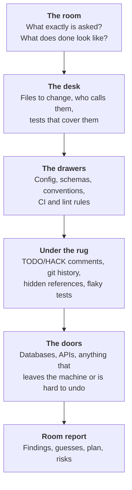

# How it works

This page explains the ideas behind the skills in more detail. If you only want to use them, the [README](../README.md) is enough.

## The room metaphor (plan-every-corner)

Before writing code, a senior developer works out what is in the "room" the task lives in. The skill follows the same path, ordered by how likely each area is to change the plan.



| Part of the room | What to look for | Mistake it prevents |
|---|---|---|
| **Room** | The task in two sentences, and an observable "done" | Building the wrong thing |
| **Desk** | Files, callers, tests | Breaking a caller you did not know about |
| **Drawers** | Config, schema, conventions, CI | Inventing a new pattern, or a change CI will reject |
| **Under the rug** | TODOs, history, hidden references, flaky tests | Bringing back a bug someone fixed on purpose |
| **Doors** | External systems, irreversible actions | A side effect nobody expected |

### Rules that keep it useful

- **Only look at what could change the plan.** Stop when one more search would not change what Claude would do.
- **Every claim has evidence:** a `file:line`, a command that was run, or a commit. Anything not checked is labeled **assumed**.
- **Missing things are reported too:** "searched for X, found nothing."
- **Depth matches risk.** A typo gets no look-around. Auth or database changes get the full pass.
- **At most three questions**, only where the answer changes the plan, each with a default so you can just say "go".

See a complete [example report](../examples/room-report-example.md).

## Permission explanations (explain-before-approve)

Every explanation has four lines: **What**, **Why**, **Changes**, **Undo**. Risky actions get a fifth: **Check this**.

The effort is scaled to the risk so explanations do not turn into noise:

| Level | Examples | What Claude writes |
|---|---|---|
| Quiet | Read files, search, `git status` | Nothing, or one line |
| Standard | Edit project files, run tests, build | The four lines |
| Careful | Delete, install, migrate, network calls, `git push`, `sudo` | The four lines plus "Check this" |

More in [permission-explanations.md](../examples/permission-explanations.md), including what Claude says when it honestly does not know what a command does.

## The hook

A skill depends on the AI remembering to follow it. A hook is a small script that runs every time, so it never forgets. [`explain-risky-commands.sh`](../hooks/explain-risky-commands.sh) checks each shell command and, for dangerous ones, attaches a plain-language warning to the permission prompt.

| Command pattern | Warning |
|---|---|
| `rm -rf` | Deletes permanently, no trash and no undo |
| `git push --force` | Overwrites the server branch; teammates' work can be lost |
| `git reset --hard` | Throws away uncommitted changes |
| `git clean -f` | Deletes untracked files that cannot be recovered |
| `curl ... \| sh` | Runs a downloaded script without you seeing it |
| `sudo` | Runs with administrator rights |
| `DROP TABLE`, `TRUNCATE TABLE` | Permanently removes database data |
| `chmod 777` | Opens files to every user on the machine |

Safe commands pass through silently. The hook never blocks anything by itself; it only makes the normal prompt clearer.

> **A safety net, not a security boundary.** Pattern matching is easy to get around and will miss things. For hard guarantees, use Claude Code's permission rules and a sandbox.

## Honest limits

- It raises the odds of a clean first attempt. It does not guarantee one. Some knowledge lives in people's heads, not in files, and the report lists that under "assumed".
- The explanation comes from the same model that proposed the action, so a wrong plan can arrive with a confident explanation.
- Explanations can become noise. Keep the three-level scheme, and edit the table in `explain-before-approve/SKILL.md` if your team finds it too chatty.

## Repo layout

```
skills/
├── skills/
│   ├── plan-every-corner/SKILL.md
│   └── explain-before-approve/SKILL.md
├── hooks/
│   ├── explain-risky-commands.sh
│   ├── test-hook.sh
│   └── README.md
├── examples/
├── docs/
├── .github/               (issue and pull request templates, CI)
├── CONTRIBUTING.md
└── LICENSE
```
