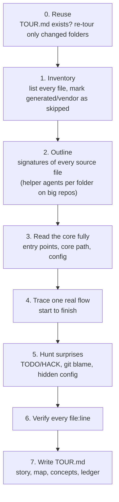
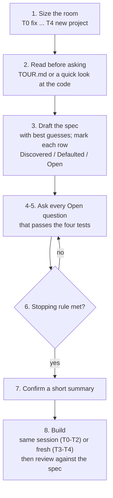
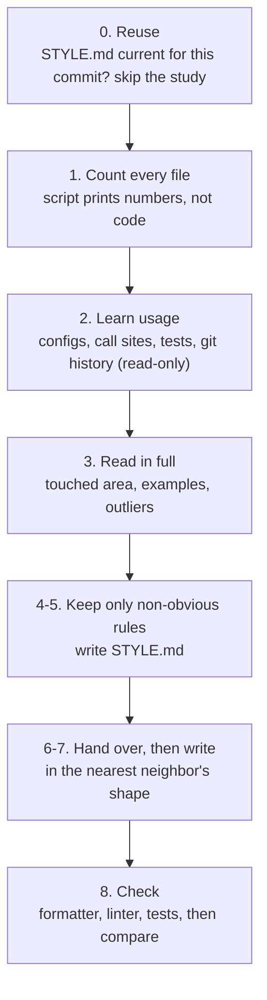

# How it works

This page explains the design behind the skills and the evidence for each choice. If you only want to use them, the [README](../README.md) is enough. For the full research behind it, with every source, see the [research report](research.md).

## The idea: your project is a house

| Skill | The house version | Writes |
|---|---|---|
| `every-corner-tour` | Someone shows you around a house that is already built | `docs/every-corner/TOUR.md` |
| `every-corner-interview` | You describe a new room; someone asks what it needs before building | `docs/every-corner/specs/<feature>.md` |
| `every-corner-matchcodebase` | Before adding a room, someone studies how the rest of the house was built so the new room matches | `docs/every-corner/STYLE.md` |
| `every-corner-explain` | Before knocking down a wall, someone tells you it can't be put back | nothing (it talks to you) |
| `every-corner-debug` | Trace a leak before repairing the wall | `docs/every-corner/debug/<bug>.md` |
| `every-corner-verify` | Test the finished room against the plan | `docs/every-corner/verification/<change>.md` |
| `every-corner-diff` | Walk through renovations before accepting them | `docs/every-corner/diffs/<change>.md` |
| `every-corner-review` | Inspect a renovation for real faults | `docs/every-corner/reviews/<change>.md` |
| `every-corner-handoff` | Leave the next builder a clear note | `docs/every-corner/HANDOFF.md` |

## every-corner-tour

**Goal:** you understand the logic of the project, as if a friend explained it, and you can check that nothing was skipped.



**Key choices:**

- **Every corner, in tiers.** Reading every line of a big project is unaffordable and doesn't help understanding. Listing every file, outlining every source file and reading only the core fully covers every corner at a fraction of the cost. Projects under about 50 source files are read fully.
- **Coverage ledger.** Every folder gets a row: Explained, Mentioned, Skipped (with a reason) or Unknown. Auto-wiki tools are reported to skip folders silently; the ledger makes that visible.
- **Verified references.** Every `file:line` is re-checked before it is written, following the code-tour validator. The README is treated as a claim to check.
- **Concepts, basic to advanced.** Each one says what you're looking at, how it works, why it matters, and the gotcha.
- **Cached by commit.** `TOUR.md` records the commit it was written at, so the next session only re-reads folders that changed.

## every-corner-interview

**Goal:** the whole room is described before any code, so it can be built right the first time.



### What the research says

| Finding | Source | What the skill does |
|---|---|---|
| Missing requirements drop accuracy by 35-52% | HumanEvalComm | Interview before building |
| Asking recovers 80-89% of full-spec performance | Ambig-SWE | Interview before building |
| Over 60% of model responses guessed instead of asking | HumanEvalComm | The skill asks deliberately |
| Strong models explore first and need about half the questions | Ambig-SWE | Read the code before asking |
| The best agents ask few, high-value questions | SAGE-Agent | Four-test filter, not a quota |
| Ordering, comparison and collection rules are missed over 80% of the time | ClarifyCodeBench | Always check data semantics |
| Closed questions go unanswered 1-2% of the time, open ones about 18% | Pew Research | Multiple choice with options |
| Every requirement needs a measurable test of success | Volere | The stopping rule |

### Room sizes

The size sets how much to read and how big the spec is. **It never caps the questions.** Hidden complexity can only move the size up.

| Tier | Signals | Spec | Build |
|---|---|---|---|
| T0 Fix | One obvious change | none | same session |
| T1 Small | One behavior, one place | half a page | same session |
| T2 Medium | Several behaviors, stored data | 1-3 pages | same session |
| T3 Large | New data model, APIs, auth or payments | 3-8 pages | fresh session |
| T4 New project | Empty folder, new product | split into sub-rooms | fresh session per sub-room |

### The four tests for a question

A question is asked only when all four hold:

1. Only the user can answer it.
2. The answer changes the code, data or tests.
3. It has not been asked already.
4. The user can realistically answer it (no library choices for non-technical users).

Anything else becomes a written default in the spec's "Decisions made for you" section.

### The room checklist

Purpose · Size and non-goals · Contents (data, identity, lifecycle, integrations) · Behavior (including empty, loading and error states) · Edge cases · **Data semantics** (ordering, duplicates, comparison, empty collections, units, precision, atomicity) · Constraints · Terminology · Done checks.

### Stopping rule

The interview ends only when no ledger row is Open, every requirement has a testable done check, no remaining choice would change the build, and the data-semantics rows have been checked. There is no question cap and no checkpoint pause. The user can say "build now" at any time; open items then become defaults marked as risks.

### Why one spec file per feature

Users of multi-file spec systems complained about ceremony and review burden (one Kiro bug fix turned into 16 acceptance criteria). One file per feature, sized to the tier, keeps the record without the paperwork. Large features are built in a fresh session from the spec, following Anthropic's documented workflow, so the interview transcript doesn't fill the context.

## every-corner-matchcodebase

**Goal:** new code in an existing project looks like the project's own code, and you can see how that was checked.



**Key choices (from the [research report](every-corner/research/matchcodebase-landscape.md)):**

- **Count, don't read.** Reading every file in full is the most expensive way to learn style. A standard-library script covers every file in one pass (about 0.2 s for 1,000 files) and returns frequencies and outliers; the model reads in full only what counts cannot tell it.
- **Configs win.** An explicit formatter or linter rule needs no note in `STYLE.md`.
- **Short notes only.** In one study, context files did not improve task success and raised cost by over 20%, except for non-standard practices (Gloaguen et al., arXiv 2602.11988). So `STYLE.md` holds only conventions the tools don't show.
- **Verify, don't trust.** Formatting is the easiest style signal to imitate, so after the formatter and linter the skill compares naming and structure with the nearest existing file.
- **Style, not defects.** Bugs and unsafe patterns in the old code are reported, not copied.
- **A hook starts it.** A skill description is a request the model may skip; a hook runs every time. The guard blocks at most once per session and never in an empty project, so it cannot loop or nag.

## every-corner-explain

**Goal:** approvals people actually read.

Users approve 93% of permission prompts (Anthropic), and attention to a warning drops sharply after the second exposure (Anderson, Vance et al.). So explanations are **rare and scaled to risk**, and the most dangerous ones **look different**.

| Level | Examples | Explanation |
|---|---|---|
| 1. Read-only | read, search, `git status` | none |
| 2. Easy to undo | edit tracked files, build, create a branch | one line |
| 3. Hard to undo | migrations, `git push`, deleting untracked files | `⚠️ HARD TO UNDO` card |
| 4. Cannot be undone | `rm -rf`, force push, `DROP TABLE`, publishing | `⛔ CANNOT BE UNDONE` card with a safer option |

The card leads with the undo label, then What, Why, Changes, Undo and "Check this". The "Why" is based on the actual command, never on text read from a file, so a malicious file cannot talk its way into a reassuring explanation.

## The hook

[`explain-risky-commands.sh`](../hooks/explain-risky-commands.sh) applies the same four levels to shell commands. Levels 1 and 2 pass silently. Levels 3 and 4 get a short warning inside the permission prompt, with a safer option where one exists. It searches the whole command text, heredocs included, so a dangerous command is found wherever it sits, and it errs toward an extra warning rather than a miss. It is covered by [`test-hook.sh`](../hooks/test-hook.sh) and CI on Linux and macOS. Setup, the off switch, headless behavior and the full list of patterns are in the [hook guide](../hooks/README.md).

## Honest limits

- No published study yet ties these techniques to one-shot build success with real developers. The evidence comes from benchmarks with simulated users, survey research and security-warning studies.
- The room-size boundaries and screen batching are judgment calls, to be tuned with real use.
- A tour is a verified map, not a full audit; the ledger tells you what was only outlined or skipped.
- **"Read only" is an instruction, not a lock.** A skill cannot take tools away for a whole conversation: Claude Code's `allowed-tools` only pre-approves tools, and `disallowed-tools` clears when you send your next message. The tour is told not to edit code or run anything but read-only commands. For a hard guarantee, run it in plan mode, which does not let Claude change files (the tour then stays in chat instead of being saved). Denying only `Edit` and `Write` is not enough: shell commands can still write files.
- Explanations come from the same model that proposed the action.
- The match skill's description alone did not start it for very small requests (two of two test runs skipped it), so a hook (`hooks/require-style-study.sh`) blocks the first source edit once per session and sends the agent to it; it then started in two of two runs. On a 5-file project it cost more than not using it ($0.43 vs $0.29, one run each). Its token cost on larger projects and its win over a no-skill baseline are not measured yet; the numbers in the research report come from other tools and papers. The counting script's outlier flags are heuristics (for example, semicolon detection in JS and TS is approximate).

## Repo layout

```
every-corner-skills/
├── .claude-plugin/
│   ├── plugin.json         (the plugin: name, version, options)
│   └── marketplace.json    (this repo as a plugin marketplace)
├── skills/
│   ├── every-corner-tour/SKILL.md
│   ├── every-corner-interview/SKILL.md
│   ├── every-corner-matchcodebase/
│   │   ├── SKILL.md
│   │   └── scripts/style-counts.py
│   └── every-corner-explain/SKILL.md
├── hooks/
│   ├── hooks.json          (registers the hook for plugin users)
│   ├── explain-risky-commands.sh
│   ├── test-hook.sh
│   ├── require-style-study.sh   (the style guard)
│   ├── test-style-guard.sh
│   └── README.md
├── evals/                  (skill trigger tests for `claude plugin eval`)
├── tests/matchcodebase/    (fixtures, script tests, headless run helper)
├── examples/
│   ├── tour-example.md
│   ├── interview-example.md
│   ├── matchcodebase-example.md
│   └── permission-explanations.md
├── docs/
│   ├── how-it-works.md
│   ├── research.md
│   └── stress-test.md
├── assets/                 (banner, icon, social preview)
├── .github/                (issue and pull request templates, CI)
├── CHANGELOG.md
├── CONTRIBUTING.md
└── LICENSE
```
