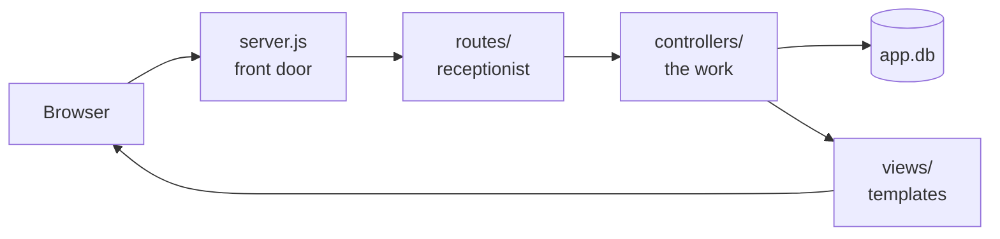

# Example: every-corner-tour

> Illustrative example. The project, files and line numbers are made up to show the format. A real tour cites (and verifies) your actual code.

**Situation:** A junior developer joins a team and says: *"I'm new here. Give me a tour of this project."*

Claude lists all 214 tracked files, outlines the 61 source files, reads the entry point and the recipe flow in full, and checks every reference below. It saves this to `docs/every-corner/TOUR.md` and gives a short summary in chat.

---

# Tour of recipe-share

Written for: new-joiner · Depth: standard · Commit: `a1b2c3d` · Date: 2026-11-15

## In one sentence

A small website where people share recipes, save favorites and leave comments.

## The story

Let's follow what happens when someone opens a recipe page.

1. Their browser asks for `/recipes/42`. The first stop is `src/server.js:12`, the front door of the app. It does nothing smart; it hands the request to the router.
2. The router (`src/routes/recipes.js:8`) works like a receptionist. It reads the address, sees "recipes" and "42", and sends the visitor to the right desk: `getRecipe`.
3. `getRecipe` (`src/controllers/recipes.js:21`) asks the database for recipe 42. The database is a single file, `data/app.db` (SQLite, a database that is just one file, so there's nothing to install).
4. It checks whether the visitor is logged in (`src/middleware/auth.js:5`), so the "Save" button only shows for people with an account.
5. It fills in the page template `views/recipe.ejs` and sends the finished page back.

**The loop:** door → receptionist → desk → database → template → page. Almost every feature here follows it.

## The map



## Concepts, from basic to advanced

### 1. Routes: which address goes where
- **What you're looking at:** `src/routes/recipes.js:8-30`, a list of addresses and the function that handles each.
- **How it works:** Each line says "when someone asks for this address with this method, call this function."
- **Why it matters:** To add a page, you start here.
- **Gotcha:** Order matters. `/recipes/new` must come before `/recipes/:id`, or "new" is treated as a recipe number (`src/routes/recipes.js:14`).

### 2. Middleware: checks before the main work
- **What you're looking at:** `src/middleware/auth.js:5`.
- **How it works:** Like a bouncer at the door. It runs before the controller and can stop the request (not logged in → login page).
- **Why it matters:** Any page that needs an account uses it.
- **Gotcha:** Comment routes forget to use it in one place (see Surprises).

*(Concepts 3-9 continue the same way: controllers, the database layer, templates, sessions, comments, favorites, tests.)*

## Glossary

- **Controller:** the function that does the actual work for one address.
- **Middleware:** a small check that runs before the controller.
- **Template:** an HTML page with gaps that get filled with data.

## How to run it and check it works

```bash
npm install     # download the libraries
npm start       # start the app, then open http://localhost:3000
npm test        # run the automatic checks; expect "42 passing"
```

## Things that will surprise you

- `src/controllers/comments.js:44`: `// HACK: comments are not escaped here`. A visitor could put code in a comment. `git blame` shows it was left on purpose "until the new editor ships" (commit `9f8e7d6`). Fix this before touching comments.
- `src/routes/comments.js:19`: deleting a comment does not use the login check. Anyone can call it.
- `RATE_LIMIT_WINDOW` is read at `src/config.js:14` but missing from `.env.example`.
- `src/utils/date.js` and `src/lib/dates.js` do nearly the same thing. I could not find out why there are two.

## Where to look when you want to...

| I want to... | Look at |
|---|---|
| change how login works | `src/middleware/auth.js`, `src/controllers/auth.js` |
| add a new page | a route in `src/routes/`, a function in `src/controllers/`, a template in `views/` |
| change what is stored | `src/db/schema.sql` (ask first: stored data is hard to change back) |

## Coverage ledger

| Folder | Files | Status | Note |
|---|---|---|---|
| `src/routes/` | 6 | Explained | Concept 1 |
| `src/controllers/` | 7 | Explained | Story, concepts 3 and 7 |
| `src/middleware/` | 3 | Explained | Concept 2 |
| `src/db/` | 4 | Explained | Concept 4 |
| `src/utils/`, `src/lib/` | 9 | Mentioned | Small helpers, outlined only |
| `views/` | 14 | Mentioned | Templates, one read in full |
| `test/` | 18 | Mentioned | Outlined; how to run them is above |
| `public/vendor/` | 140 | Skipped | Third-party code copied in |
| `data/` | 1 | Skipped | The database file |
| `scripts/legacy/` | 3 | Unknown | Nothing seems to call these |

## What you can do now

1. Run the app and the tests.
2. Add a simple page using the routes → controllers → views pattern.
3. Fix the comment escaping HACK (a good first task with real impact).

---

**In chat, Claude adds:** "Short version: it's a recipe site where every request goes door → receptionist → desk → database → page. The two things to know first are the unescaped comments and the delete-comment route without a login check. The full tour is in `docs/every-corner/TOUR.md`. Want me to go deeper on something, or start a feature?"
